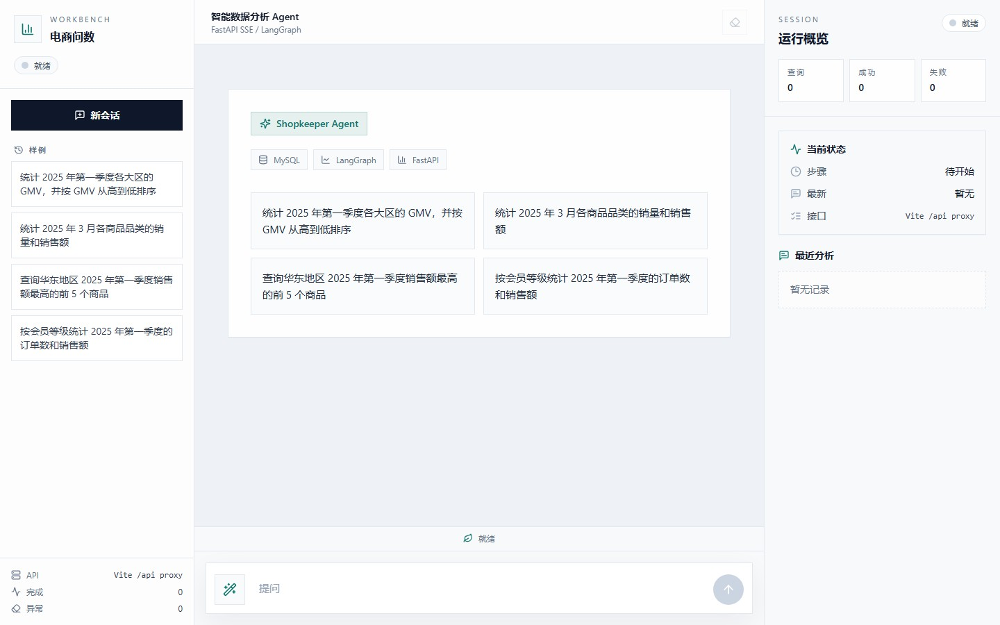
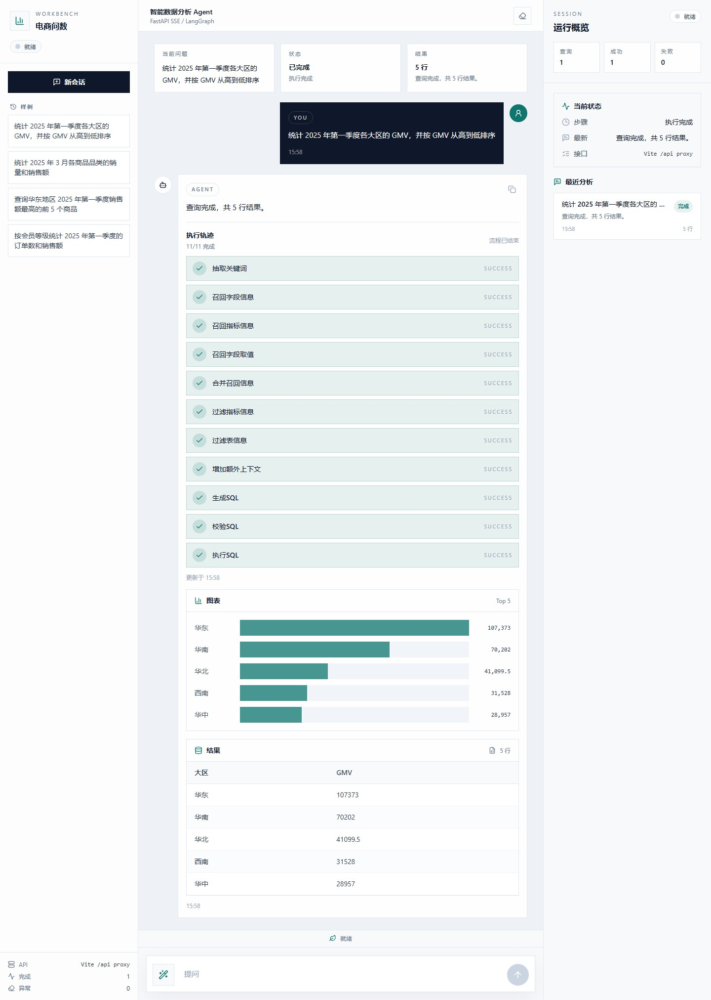
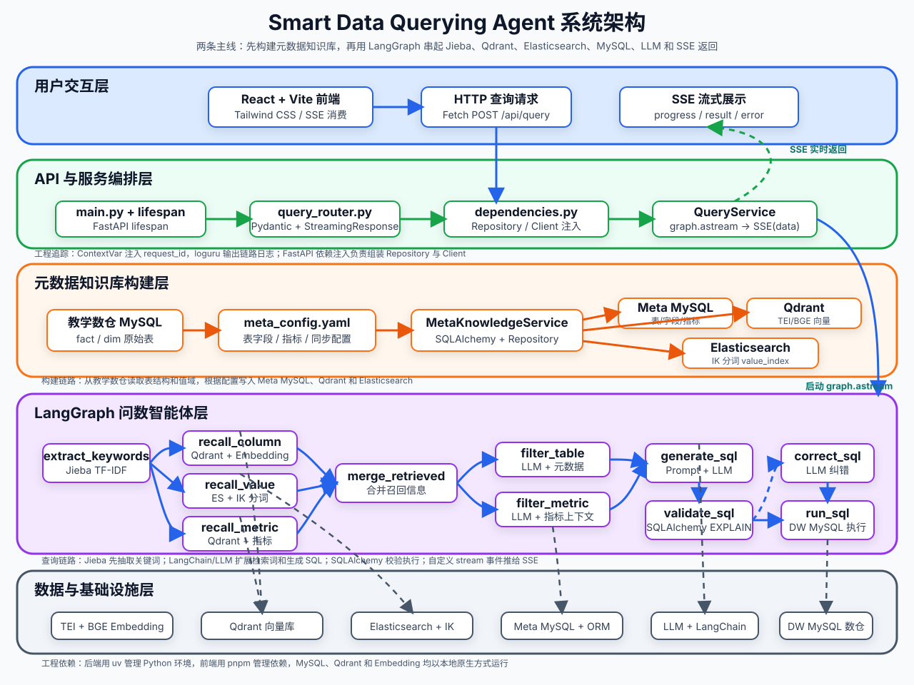

<div align="center">
  <h1 style="margin-top: 15px;">Smart Data Querying Agent</h1>
  <h3>电商智能问数系统</h3>
  <p><em>面向电商数仓的自然语言数据查询工作台，串联元数据检索、SQL 生成与校验、MySQL 查询和结果展示。</em></p>
</div>

<div align="center">


</div>







## 项目简介

这个项目面向电商数据分析场景，解决业务人员查询数据时需要依赖 SQL 和数据开发的问题。用户输入自然语言问题，系统根据元数据和字段取值生成查询上下文，再生成经过安全校验的 SQL，从 MySQL 数仓返回结果。

现在这版已经把召回、生成、校验、执行和展示串成了一条完整链路:

- 用户输入自然语言问题
- 系统召回相关字段、指标和字段取值
- LangGraph 组织多阶段问数流程
- 生成 SQL、校验 SQL、执行 SQL
- 结果通过 SSE 流式返回到前端

前端也改成了三栏工作台，不再只是单一聊天框:

- 左侧是样例问题、新会话和接口状态
- 中间是对话区、当前问题、执行状态和结果摘要
- 右侧是运行概览、最近分析记录和历史结果打开入口

## 现在的前端

前端界面采用三栏工作台，围绕一次查询所需的信息组织布局:

1. 左侧提供样例问题、新建会话和接口状态。
2. 中间展示对话、执行进度、SQL 和查询结果。
3. 右侧保存最近分析记录，可恢复或删除历史查询。
4. 结果表格会识别维度列和数值列，并提供轻量图表辅助阅读。

移动端会自动收敛成单栏布局，桌面端保持三栏。

## 核心能力

- 混合检索: 默认本地模式使用嵌入式 `Qdrant` 完成字段和指标语义召回，并使用本地持久化字段值索引；外部模式可切换到 `Elasticsearch`。
- 流程编排: `LangGraph` 负责把召回、过滤、生成、校验和执行串起来。
- 实时返回: 后端通过 `SSE` 推送节点进度、结果和错误信息。
- 结果展示: 前端同时提供结果表格和轻量柱状图，便于快速读数。
- 历史追踪: 查询记录持久化到 MySQL，右侧面板可查看最近分析。
- 历史管理: 支持打开历史结果和删除单条查询记录，运行中的任务不会被误删。
- 数据落地: 元数据库和教学数仓都接到本地 MySQL，Navicat 里可以直接看 `meta` 和 `dw` 两个库。
- 运行模式: 默认配置为完整 API 模式；只有显式设置 `SMART_DATA_QUERYING_AGENT_DEMO_MODE=true` 时才启用本地演示链路。
- 安全边界: SQL 经过 `sqlglot` AST 解析和 MySQL `EXPLAIN` 双重校验，只允许单条只读 `SELECT`。
- 纠错闭环: SQL 校验失败后最多自动修正 2 次，每次修正都会重新经过 AST 和 `EXPLAIN` 校验，超过上限则明确失败。
- 稳定性: 查询设置服务端超时，启动时检查外部依赖，并清理遗留的运行中历史记录。
- 可复现召回: 关键词和扩展词采用保序去重，避免集合遍历造成召回顺序不稳定。

## 技术栈

| 模块 | 技术 | 作用 |
| --- | --- | --- |
| 智能体编排 | `LangGraph` | 组织多阶段问数流程 |
| 后端接口 | `FastAPI` | 提供问数 API 和生命周期管理 |
| 流式协议 | `SSE` | 推送执行进度和结果 |
| 元数据存储 | `MySQL` / `SQLAlchemy` | 保存表、字段、指标等结构化信息 |
| 查询历史 | `MySQL` | 保存问题、状态、摘要、结果和错误信息 |
| SQL 安全 | `sqlglot` + `EXPLAIN` | 限制只读查询并在执行前校验 |
| 向量检索 | `Qdrant` | 本地模式使用嵌入式存储，外部模式连接 Qdrant 服务 |
| 字段值检索 | 本地索引 / `Elasticsearch` | 本地模式无需额外服务，外部模式支持 Elasticsearch |
| 本地 Embedding | `PyTorch` / `Transformers` | 加载 BGE 模型生成 1024 维向量 |
| 前端 | `React` / `Vite` / `Tailwind CSS` | 提供三栏工作台和结果展示 |
| 依赖管理 | `uv` / `pnpm` | 管理后端和前端依赖 |

## 项目结构

```text
smart-data-querying-agent/
├── app/                  # 后端业务代码、智能体、接口、服务和仓储
├── conf/                 # app_config.yaml、meta_config.yaml
├── docs/                 # 项目截图和架构图
├── frontend/             # React + Vite + Tailwind CSS 前端
├── prompts/              # SQL 生成、修正和过滤模板
├── sql/                  # meta 和 dw 数据库初始化脚本
├── models/               # 本地 BGE 模型目录（不提交到仓库）
├── main.py               # FastAPI 应用入口
└── pyproject.toml        # Python 依赖和工具配置
```

## 本地运行

项目默认使用完整 API 模式和本地原生模式，所有组件都直接运行在本机，不依赖容器环境。真实数据来自本地 MySQL，字段和指标向量写入本地嵌入式 Qdrant，字段取值写入本地索引文件，Embedding 直接加载本地 BGE 模型，大模型使用兼容 OpenAI 的 API。`SMART_DATA_QUERYING_AGENT_DEMO_MODE` 默认保持关闭；只有显式设置为 `true` 才会进入演示链路。

### API 接口

| 方法 | 路径 | 说明 |
| --- | --- | --- |
| `POST` | `/api/query` | 提交自然语言问题，返回 SSE 流 |
| `GET` | `/api/query/history` | 获取最近查询历史 |
| `DELETE` | `/api/query/history/{history_id}` | 删除单条查询历史 |

完整模式下，外部服务或本地索引缺失会返回明确错误，不会静默生成演示结果。

### 1. 准备环境

- Python `>= 3.14`
- `uv`
- Node.js
- `pnpm`
- 本地 BGE 模型文件（默认路径为 `models/bge-large-zh-v1.5`）

### 2. 克隆项目

```bash
git clone https://github.com/qiqiqi-max/smart-data-querying-agent.git
cd smart-data-querying-agent
```

### 3. 安装后端依赖

```bash
uv sync
```

### 4. 准备本地数据库

先把 [sql/meta.sql](sql/meta.sql) 和 [sql/dw.sql](sql/dw.sql) 导入本地 MySQL。脚本会创建 `meta`、`dw` 两个库和项目专属账号 `smart-data-querying-agent` / `123456`，需要使用有建库和授权权限的账号执行：

```bash
mysql -u root -p < sql/meta.sql
mysql -u root -p < sql/dw.sql
```

也可以在 Navicat 中连接本机 MySQL 后依次运行这两个 SQL 文件。

复制 `.env.example` 为 `.env`，确认以下配置保持为本地完整模式：

```env
SMART_DATA_QUERYING_AGENT_DEMO_MODE=false
SMART_DATA_QUERYING_AGENT_LOCAL_MODE=true
EMBEDDING_MODEL_PATH=models/bge-large-zh-v1.5
```

项目仓库不会提交体积较大的模型文件。可以从 [BAAI/bge-large-zh-v1.5](https://huggingface.co/BAAI/bge-large-zh-v1.5) 下载后放到 `EMBEDDING_MODEL_PATH` 指定的目录。

### 5. 构建本地知识库

```bash
uv run python -m app.scripts.build_meta_knowledge -c conf/meta_config.yaml
```

这一步会从 `dw` 读取真实表结构和字段值，将结构化元数据写入 `meta`，并生成 `.local-data/qdrant` 和 `.local-data/value_index.json`。构建脚本可以重复执行。

### 6. 启动后端

```bash
uv run fastapi dev main.py
```

### 7. 启动前端

```bash
cd frontend
pnpm install
pnpm dev
```

默认前端通过 `/api` 代理到 `http://127.0.0.1:8001`。需要手动改地址时，调整 `frontend/.env` 里的 `VITE_DEV_PROXY_TARGET` 或 `VITE_API_BASE_URL`。完整模式下不提供公网认证能力，建议仅在本地或受保护网络中运行。

如果需要连接独立的 Qdrant、Elasticsearch 和 Embedding 服务，将 `SMART_DATA_QUERYING_AGENT_LOCAL_MODE` 设置为 `false`，并按 `conf/app_config.yaml` 配置对应地址。

## 数据库说明

当前配置使用本地 MySQL。

- 元数据库: `meta`
- 教学数仓: `dw`
- 查询历史表: `meta.query_history`
- 账号: `smart-data-querying-agent`
- 密码: `123456`

Navicat 里直接连本机 `3306` 就能看到这两个库。

## 项目现状

当前版本已经打通本地 MySQL、元数据构建、本地向量检索、字段值检索、问数链路、查询历史、前端三栏工作台、图表和结果表格。完整模式依赖缺失时会在启动阶段明确报错，不会自动降级到演示链路。

当前验证状态：后端 `pytest` 通过 21 项，Ruff 检查通过，Python 编译检查通过，前端 TypeScript 检查和生产构建通过，并已验证本地完整链路可以生成 SQL、查询 `dw` 并通过 SSE 返回结果。项目适合本地演示和二次开发；当前未配置登录鉴权，不建议直接部署到公网。
