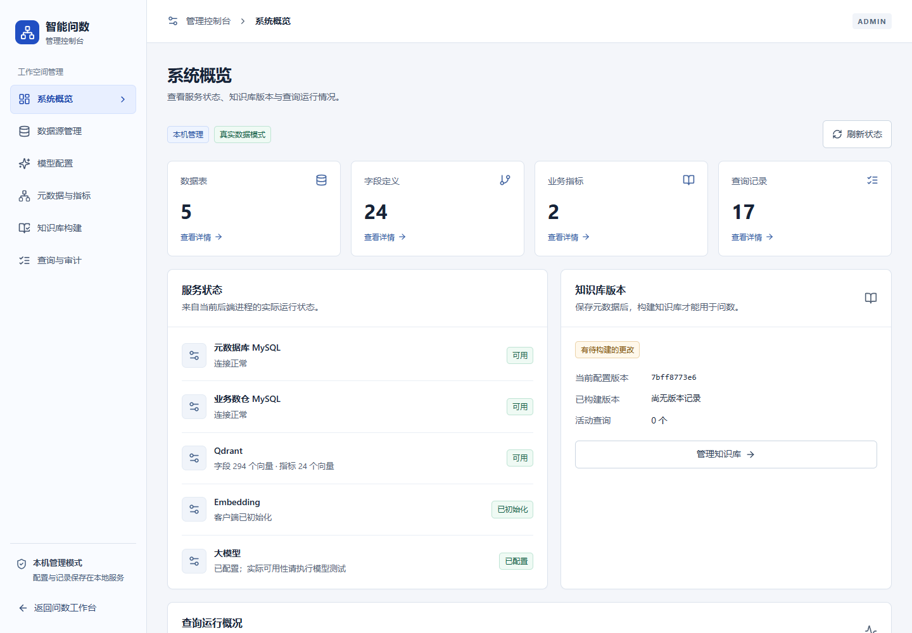

# 后台管理台

从问数工作台侧栏点击 **后台管理**，或访问 `http://127.0.0.1:5174/#/admin`。前端端口以启动时输出为准。

后台面向当前项目的本机单用户管理，提供六个页面，正文 14px。没有多租户和用户角色管理；管理 API 限定本机来源，前端开发服务默认仅监听 `127.0.0.1`。部署时保持单个后端工作进程，知识库维护锁和本地 Qdrant 由该进程管理。



## 页面与操作

| 页面 | 能力 |
| --- | --- |
| 系统概览 | 表、字段、指标、查询统计，MySQL/Qdrant 状态，配置和构建版本，维护状态 |
| 数据源管理 | 管理现有 meta/dw 两个 MySQL 连接，测试当前输入，查看真实数仓表结构 |
| 模型配置 | 模型名称、兼容 API 地址、密钥输入及真实调用测试 |
| 元数据与指标 | 新增、编辑、删除表和字段，说明、别名、字段角色、字段值同步开关、指标及引用维护，从真实数仓选择导入 |
| 知识库构建 | 全量重建、实际阶段进度、最近 50 次任务、失败原因及重启中断恢复 |
| 查询与审计 | 分页、关键词和状态筛选，结果与 SQL 查看/复制/CSV 导出，删除已结束记录，最近 50 条管理审计 |

## 配置生效与凭据

数据源和模型配置保存在 `.local-data/admin/settings.json`，下次后端启动时覆盖 YAML/环境变量中的对应值。页面分别显示已保存配置和运行中配置；显示“等待重启”时，停止后端进程，再从项目根目录运行：

```powershell
uv run uvicorn main:app --host 127.0.0.1 --port 8001
```

后台不提供在浏览器里启动系统进程的按钮。连接测试只验证当前输入，不保存设置。密钥、密码不回显，输入留空表示保留；更换服务地址或数据库用户名时须重新输入凭据。模型测试会产生一次实际 API 调用。

配置文件包含运行所需的本地凭据，已在 Git 忽略目录内；备份应按秘密文件处理。若保存错误配置导致启动失败，可在停止服务后修正该文件，或将其改名以恢复 `.env` 和 `conf/app_config.yaml` 的配置。

## 元数据到知识库

1. 检查数据源连接及模型可用性。
2. 在“元数据与指标”从数仓导入或编辑定义，点击“校验配置”和“保存元数据”。表单草稿保存在当前页面，保存目标是 `conf/meta_config.yaml`。
3. 在“知识库构建”确认全量重建。系统先校验真实表列，再更新元数据库、字段向量、字段取值、指标关系和指标向量。
4. 六个阶段完成后恢复查询，记录构建的配置版本。各阶段耗时不同，进度是已完成阶段数，不是时间百分比。

表、字段、指标的删除只修改业务定义；不会删除数仓原始表或数据。重建会完整替换智能体使用的派生元数据和索引。活动查询存在时不能开始重建；重建期间不能发起新查询或保存元数据。

重建不是跨 MySQL/Qdrant/ES 的原子事务。任一阶段失败或被服务重启中断时，系统保持维护状态；检查数据源、字段及索引服务后再次成功重建即可恢复。任务最长运行 30 分钟。旧项目升级后可能已有索引但尚无后台版本记录，首次通过后台构建后才会记录版本。

## 接口

管理接口统一前缀 `/api/admin`，详情见运行中的 `/docs`。

- `GET /overview`：状态和统计。
- `GET/PUT /settings`：设置读取与保存（包含 revision 乐观锁）。
- `POST /test-database/{meta|dw}`、`POST /test-model`：连接测试。
- `GET /schema`：当前数仓表列。
- `GET/PUT /metadata`：元数据定义，保存需要 revision。
- `GET/POST /builds`：任务历史与启动全量构建。
- `GET /queries`：page、page_size、q、status 筛选。
- `GET/DELETE /queries/{id}`：详情和删除。
- `GET /audit`：限量操作记录。

管理变更要求 JSON 请求。跨窗口修改冲突返回 409，输入错误返回 422，前端保留草稿供修正。数据库/模型测试错误和校验错误不返回密码或密钥。

## 验证范围

本轮进行了全套 Python 测试、Ruff、TypeScript 与 Vite 构建；Edge 实际访问六页、真实 MySQL 连接测试、真实模型调用、真实表结构和历史详情。使用临时 SQLite、内存 Qdrant、本地临时字段值索引，配合真实 MySQL 数仓和本地 BGE 完成六阶段全量构建及检索验证。

保存、冲突、错误、构建轮询、取消确认、移动导航等场景分别通过隔离接口测试与浏览器受控响应验证。未改动当前真实凭据、数仓源数据和原有查询历史，也未覆盖当前使用的知识库。
